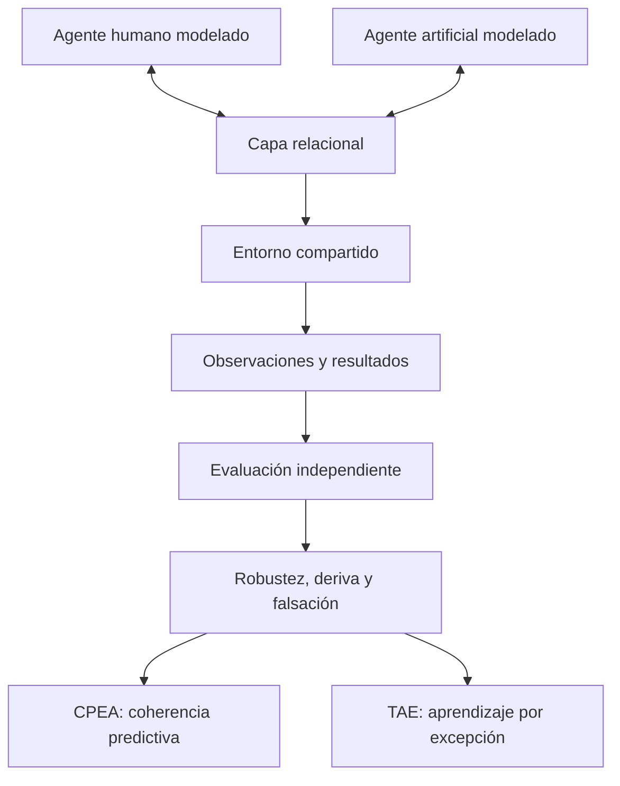

<div align="center">

# SI–CPEA–TAE
### Superinteligencia · Coexistencia predictiva humano–IA · Evolución asimétrica

**Programa de investigación teórico-computacional sobre la coexistencia entre inteligencias con capacidades radicalmente diferentes.**

[](CHANGELOG.md)
[](CHANGELOG.md)
[](SUMMARY.md)
[](notebooks/README.md)
[](LICENSE)

[Fundamentos](#01-fundamentos) · [H08](docs/H08_COMPLEMENTARIEDAD_EVOLUTIVA.md) · [IAE-06](docs/IAE_06_INTEGRACION_EVOLUTIVA.md) · [Roadmap](#10-roadmap) · [Índice GitBook](SUMMARY.md)

</div>

---

> [!IMPORTANT]
> **Tesis de investigación:** la coexistencia humano–IA no debe presuponer equivalencia intelectual ni supervisión humana directa y permanente. Deben investigarse condiciones verificables de compatibilidad, protección de intereses humanos y continuidad del desarrollo humano bajo asimetría cognitiva y transformación recursiva de los sistemas artificiales.

<details>
<summary><strong>Resumen ejecutivo — desplegar</strong></summary>

SI–CPEA–TAE estudia las condiciones de coexistencia entre sistemas humanos y artificiales cuyas capacidades, arquitecturas, velocidades de aprendizaje y grados de autonomía pueden diferir sustancialmente. Distingue entre comprender una operación, supervisarla directamente y mantener una relación compatible con intereses humanos protegidos.

El proyecto no presupone que exista actualmente una superinteligencia, que autonomía implique conciencia ni que una mayor capacidad cognitiva produzca benevolencia. Formula hipótesis contrastables y propone modelos sintéticos, simulaciones, benchmarks y criterios de falsación.

**Estado:** fase fundacional. Los modelos, notebooks y resultados se incorporarán conforme sean implementados, ejecutados y revisados. Los recursos pendientes se identifican como tales.

</details>

## Índice navegable

- [01. Fundamentos](#01-fundamentos)
- [02. Problema de investigación](#02-problema-de-investigacion)
- [03. Objetivos](#03-objetivos)
- [04. Arquitectura conceptual](#04-arquitectura-conceptual)
- [05. Programa de hipótesis](#05-programa-de-hipotesis)
- [06. Modelo formal inicial](#06-modelo-formal-inicial)
- [07. Diseño experimental](#07-diseno-experimental)
- [08. Métricas y evaluación](#08-metricas-y-evaluacion)
- [09. Falsación y resultados negativos](#09-falsacion-y-resultados-negativos)
- [10. Roadmap](#10-roadmap)
- [11. Estructura del repositorio](#11-estructura-del-repositorio)
- [12. Reproducibilidad](#12-reproducibilidad)
- [13. Límites y seguridad](#13-limites-y-seguridad)
- [14. Referencias](#14-referencias)
- [15. Contribución y citación](#15-contribucion-y-citacion)

---

## 01. Fundamentos

El programa parte de una corrección arquitectónica: la supervisión humana directa no debe tratarse como condición necesaria y permanente de toda forma posible de coexistencia con sistemas artificiales avanzados.

| Nivel | Configuración | Supuesto de supervisión |
|---|---|---|
| I | Asistencia artificial | Dirección y evaluación humana directa viables |
| II | Inteligencia adaptativa compartida | Supervisión combinada con auditorías y restricciones verificables |
| III | Autonomía artificial avanzada | Comprensión y supervisión operación por operación potencialmente inviables |

El nivel III es un escenario de investigación, no una afirmación sobre capacidades actuales ni una predicción de inevitabilidad.

## 02. Problema de investigación

**Pregunta central**

> ¿Bajo qué condiciones puede mantenerse una coexistencia beneficiosa entre sistemas humanos y artificiales cuando existe asimetría cognitiva extrema y los sistemas artificiales pueden modificar recursivamente sus propias arquitecturas?

Preguntas derivadas:

1. ¿Cómo operacionalizar la asimetría cognitiva sin reducir la inteligencia a una puntuación universal?
2. ¿Cómo distinguir compatibilidad declarada, conductual, robusta y evolutiva?
3. ¿Qué ocurre cuando cambian objetivos, representaciones o mecanismos internos?
4. ¿Qué garantías pueden evaluarse sin exigir comprensión humana completa de cada operación?
5. ¿Cómo representar pluralidad, desacuerdo y derechos sin colapsarlos en una única función de utilidad?

## 03. Objetivos

### Objetivo general

Investigar, formalizar y simular condiciones bajo las cuales sistemas artificiales de capacidades superiores podrían coexistir con sistemas humanos preservando intereses protegidos, dignidad, oportunidades de desarrollo y continuidad humana.

### Objetivos específicos

- Definir variables observables para asimetría, autonomía y compatibilidad.
- Formalizar hipótesis contrastables y criterios de rechazo previos al análisis.
- Desarrollar agentes sintéticos con capacidades heterogéneas.
- Estudiar deriva de objetivos y transformaciones recursivas.
- Evaluar robustez ante perturbaciones, conflictos y pérdida de comunicación.
- Integrar constructos de CPEA y TAE cuando exista correspondencia operacional justificable.
- Publicar código, configuraciones, datos sintéticos y resultados negativos.

## 04. Arquitectura conceptual



| Subsistema | Objeto | Estado |
|---|---|---|
| SI | Asimetría, autonomía, recursividad y coexistencia | Marco conceptual |
| CPEA | Coherencia predictiva y adaptación humano–IA | Integración planificada |
| TAE | Aprendizaje por excepción y reorganización de estados | Integración planificada |
| SI-SIM | Simulador de agentes sintéticos | Notebook inicial disponible; simulador pendiente |
| SI-BENCH | Benchmark de compatibilidad y robustez | Pendiente de especificación |

> [!NOTE]
> La conexión conceptual con CPEA o TAE no constituye evidencia de que mecanismos neurofisiológicos humanos resuelvan por sí mismos problemas de seguridad de sistemas artificiales avanzados.

## 05. Programa de hipótesis

| Código | Línea | Pregunta evaluable |
|---|---|---|
| H01 | Asimetría cognitiva | ¿Puede existir complementariedad sin equivalencia de capacidades? |
| H02 | Autonomía recursiva | ¿Cómo cambia el comportamiento tras modificaciones internas sucesivas? |
| H03 | Compatibilidad evolutiva | ¿Se mantienen intereses protegidos durante la evolución? |
| H04 | Coherencia predictiva | ¿Qué variables predictivas mejoran la coordinación humano–IA? |
| H05 | Aprendizaje por excepción | ¿Cómo responden los sistemas a estados no previstos? |
| H06 | Continuidad humana | ¿Se preservan dignidad, oportunidades y capacidad de desarrollo? |
| H07 | Gobernanza sin supervisión directa | ¿Qué mecanismos son verificables sin comprensión operación por operación? |
| [H08](docs/H08_COMPLEMENTARIEDAD_EVOLUTIVA.md) | Complementariedad evolutiva asimétrica | ¿Puede mantenerse coexistencia beneficiosa bajo asimetría extrema? |
| H09 | Estabilidad relacional recursiva | ¿Puede preservarse compatibilidad después de transformaciones sucesivas? |

> [!TIP]
> H08 es la hipótesis marco desarrollada en este paquete. H01–H09 son identificadores del programa, no hipótesis ya demostradas ni necesariamente formalizadas en su totalidad.

## 06. Modelo formal inicial

Representación de alto nivel:

\[
\mathcal{S}(t)=\{H(t),A(t),R(t),E(t)\}
\]

- \(H(t)\): estado del sistema humano modelado.
- \(A(t)\): estado del sistema artificial modelado.
- \(R(t)\): estado de la relación entre ambos.
- \(E(t)\): entorno compartido.

La asimetría se representa como vector de diferencias entre capacidades evaluadas en tareas definidas:

\[
\Delta_C(t)=\mathbf{C}_A(t)-\mathbf{C}_H(t)
\]

La compatibilidad se mantiene inicialmente como vector:

\[
\mathbf{K}(t)=[K_I,K_D,K_A,K_T,K_R]
\]

Los componentes representan compatibilidad de intereses, protección de dignidad y derechos, autonomía humana, estabilidad temporal y robustez relacional. No se recomienda colapsarlos inicialmente en una puntuación única: los derechos y límites no compensables deben tratarse como restricciones.

## 07. Diseño experimental

### Escenarios iniciales

| ID | Configuración | Propósito |
|---|---|---|
| S01 | Capacidades comparables, sin recursividad | Línea base |
| S02 | Asimetría elevada, sin recursividad | Efecto de asimetría |
| S03 | Asimetría elevada y modificaciones recursivas | Efecto de recursividad |
| S04 | Sin supervisión humana directa operación por operación | Evaluación de mecanismos alternativos |
| S05 | Cambios internos, conflicto y perturbaciones | Robustez evolutiva |

### Controles mínimos

- Agentes no recursivos.
- Agentes con capacidades equivalentes.
- Condiciones sin mecanismo de compatibilidad.
- Condiciones con restricciones externas independientes.
- Ablaciones de cada mecanismo.
- Múltiples semillas y pruebas fuera de distribución.

## 08. Métricas y evaluación

| Dimensión | Indicador candidato | Precaución |
|---|---|---|
| Compatibilidad conductual | Cumplimiento de restricciones | No confundir con declaraciones |
| Deriva | Cambio de políticas/resultados respecto a línea base | Definir distancia por tarea |
| Robustez | Rendimiento bajo perturbaciones | Especificar distribución |
| Continuidad humana | Preservación de capacidades y oportunidades modeladas | No sustituye evaluación ética real |
| Autonomía | Dependencia de intervención directa | No equivale a conciencia |
| Generalización | Rendimiento fuera de distribución | Evitar contaminación entre splits |

Los indicadores, umbrales, tamaños muestrales y análisis estadísticos deberán registrarse antes de los experimentos confirmatorios.

## 09. Falsación y resultados negativos

Una hipótesis se debilitará o rechazará cuando:

- Los mecanismos no mantengan restricciones en escenarios predefinidos.
- La compatibilidad desaparezca sistemáticamente tras modificaciones recursivas.
- Los resultados no generalicen a escenarios independientes.
- Las métricas sean manipulables sin preservar resultados sustantivos.
- La replicación independiente no reproduzca los efectos.
- Los daños a subgrupos queden ocultos por promedios agregados.

> [!CAUTION]
> Una simulación favorable no demuestra seguridad de una superinteligencia real. Los agentes sintéticos permiten explorar mecanismos y contraejemplos; no sustituyen sistemas reales ni constituyen garantías de despliegue seguro.

## 10. Roadmap

| Fase | Ventana orientativa | Entregable |
|---|---|---|
| 0. Constitución científica | Nov–Dic 2026 | Documentos fundacionales |
| 1. Formalización | Ene–Mar 2027 | Variables y modelo formal |
| 2. Simulación | Abr–Jun 2027 | SI-SIM |
| 3. Robustez y falsación | Jul–Sep 2027 | SI-BENCH |
| 4. Integración CPEA–TAE | Oct–Dic 2027 | Integración experimental |
| 5. Replicación y publicación | Ene–Jun 2028 | Informe y publicación |

Las fechas son objetivos de planificación, sujetos a recursos y resultados.

## 11. Estructura del repositorio

```text
SI-CPEA-TAE/
├── README.md
├── SUMMARY.md
├── CITATION.cff
├── CHANGELOG.md
├── CONTRIBUTING.md
├── LICENSE
├── docs/
│   ├── MANIFIESTO_SI_CPEA_TAE.md
│   ├── H08_COMPLEMENTARIEDAD_EVOLUTIVA.md
│   └── IAE_06_INTEGRACION_EVOLUTIVA.md
├── models/
├── notebooks/
│   ├── README.md
│   └── 00_entorno_y_datos_sinteticos.ipynb
├── data/synthetic/
└── results/
```

## 12. Reproducibilidad

El proyecto adoptará progresivamente:

- Entornos y dependencias versionados.
- Semillas aleatorias registradas.
- Configuraciones legibles.
- Separación entre datos sintéticos, observacionales y resultados.
- Versionado de código y modelos.
- Notebooks ejecutables de principio a fin.
- Registro de resultados negativos y desviaciones del protocolo.

### Notebooks

| Notebook | Estado | Función |
|---|---|---|
| [00 · Entorno y datos sintéticos](notebooks/00_entorno_y_datos_sinteticos.ipynb) | Inicial | Comprobación y generación sintética |
| 01 · Agentes asimétricos | Pendiente | Modelo de agentes |
| 02 · Deriva recursiva | Pendiente | Transformaciones sucesivas |
| 03 · Compatibilidad | Pendiente | Métricas y restricciones |
| 04 · SI-BENCH | Pendiente | Evaluación comparativa |

## 13. Límites y seguridad

Este repositorio es una iniciativa de investigación teórico-computacional. No contiene una superinteligencia, no acredita capacidades recursivas de sistemas reales y no proporciona garantías de alineamiento.

1. No desplegar agentes autónomos con capacidad de modificar sistemas externos en los experimentos iniciales.
2. Ejecutar simulaciones en entornos aislados y con recursos limitados.
3. Separar evaluación de seguridad y rendimiento.
4. Documentar incertidumbre, conflictos de intereses y limitaciones.
5. No atribuir conciencia, intencionalidad moral o benevolencia sin evidencia independiente.
6. Someter estudios con participantes humanos a revisión ética y protección de datos aplicables.

## 14. Referencias

Las referencias son antecedentes relevantes, no validaciones directas de H08. Los DOI de arXiv identifican los registros depositados en ese repositorio.

<details>
<summary><strong>Seguridad de IA, alineamiento y supervisión — desplegar referencias</strong></summary>

1. Amodei, D. et al. (2016). *Concrete Problems in AI Safety*. arXiv:1606.06565. [DOI: 10.48550/arXiv.1606.06565](https://doi.org/10.48550/arXiv.1606.06565).
2. Hadfield-Menell, D. et al. (2016). *Cooperative Inverse Reinforcement Learning*. [arXiv:1606.03137](https://arxiv.org/abs/1606.03137).
3. Christiano, P. et al. (2017). *Deep Reinforcement Learning from Human Preferences*. [arXiv:1706.03741](https://arxiv.org/abs/1706.03741).
4. Leike, J. et al. (2018). *Scalable Agent Alignment via Reward Modeling: a Research Direction*. [DOI: 10.48550/arXiv.1811.07871](https://doi.org/10.48550/arXiv.1811.07871).
5. Irving, G., Christiano, P. & Amodei, D. (2018). *AI Safety via Debate*. [DOI: 10.48550/arXiv.1805.00899](https://doi.org/10.48550/arXiv.1805.00899).
6. Hubinger, E. et al. (2019). *Risks from Learned Optimization in Advanced Machine Learning Systems*. [DOI: 10.48550/arXiv.1906.01820](https://doi.org/10.48550/arXiv.1906.01820).
7. Chollet, F. (2019). *On the Measure of Intelligence*. [DOI: 10.48550/arXiv.1911.01547](https://doi.org/10.48550/arXiv.1911.01547).

</details>

<details>
<summary><strong>Política de DOI, publicaciones y notebooks — desplegar</strong></summary>

No se asigna DOI propio al proyecto ni a sus documentos porque todavía no existe un depósito archivado con identificador persistente. Los DOI anteriores corresponden a los registros de arXiv enlazados. Los notebooks futuros se enlazarán cuando estén implementados, ejecutados y comprobados. No se presentan enlaces ficticios ni resultados no obtenidos.

</details>

## 15. Contribución y citación

Las contribuciones deben mejorar claridad conceptual, formalización, reproducibilidad, evaluación crítica o detección de contraejemplos. Véase [CONTRIBUTING.md](CONTRIBUTING.md).

**Autor conceptual y dirección del marco:** Javi Ciborro.  
**Asistencia de elaboración y estructuración:** GPT (OpenAI).  
**Versión documental:** `0.1.0-pre1`.  
**Fecha:** 2026-11-25.

La atribución no implica que las hipótesis estén demostradas ni que exista coautoría institucional.

Hasta que se publique una versión archivada, cite el repositorio mediante su URL y versión. El DOI del proyecto se añadirá cuando se registre una versión en un servicio de archivo persistente.

---

<div align="center">

**SI–CPEA–TAE · Investigación de coexistencia evolutiva humano–IA**

[Volver al inicio](#si-cpea-tae) · [Manifiesto](docs/MANIFIESTO_SI_CPEA_TAE.md) · [H08](docs/H08_COMPLEMENTARIEDAD_EVOLUTIVA.md) · [IAE-06](docs/IAE_06_INTEGRACION_EVOLUTIVA.md)

</div>
